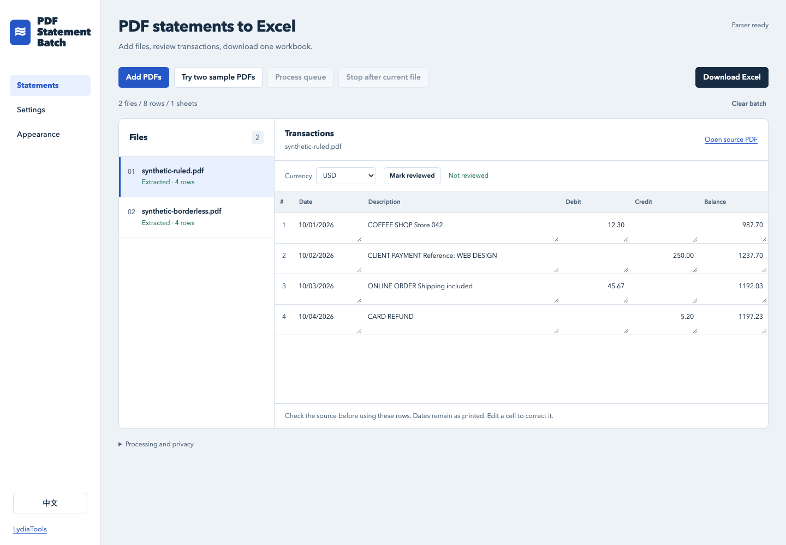

# PDF Statement Batch

**A folder of PDF statements. One workbook you can actually review.**

Process text-based PDFs in your browser, check the extracted rows and download an Excel workbook with a complete file ledger. English and Chinese interfaces. No account or AI API key.

[Open the app](https://lydiatools.github.io/pdf-statement-batch/) · [中文版](https://lydiatools.github.io/pdf-statement-batch/?lang=zh) · [Download v0.2.1 preview](https://github.com/LydiaTools/pdf-statement-batch/releases/tag/v0.2.1) · [中文说明](README.zh-CN.md)



## What it does

- Adds several PDFs to a sequential queue, with a visible result for every selected file.
- Keeps source filenames and extracted row order beside transactions.
- Lets you correct cells, confirm currencies and mark a file reviewed.
- Saves a self-contained batch ZIP with original PDFs, edits, file statuses and review progress; reopen it later to continue.
- Exports matching column/currency groups into separate transaction sheets in one `.xlsx`; a **Files** sheet includes failures, cancellations and exact duplicates.
- Preserves date text and keeps formula-looking descriptions as literal strings. Clear amount columns can use numeric cells; ambiguous or high-precision values that reach the workbook as text remain text. Parsing can still misplace or omit amounts; compare each row with the original PDF. Text-based fallback parsing can change signs or precision, so the app leaves those amounts blank for you to enter from the original PDF.
- Provides two original fictional PDFs so you can try the complete path without using a bank document.

## Try it

Open the app, choose **Try two sample PDFs**, then **Process queue**. Inspect both files and select **Download Excel**. The samples are fictional; you do not need a bank statement to try it. First use needs a connection to download the parser runtime.

The [release ZIP](https://github.com/LydiaTools/pdf-statement-batch/releases/tag/v0.2.1) includes a ready-to-serve `app/` folder. With Python 3, run this command from the extracted folder:

```sh
python3 -m http.server 4173 --bind 127.0.0.1 --directory app
```

Open `http://127.0.0.1:4173`. This is a browser app, not a native installer.

## Build from source

Node.js 20+ and Python 3 are sufficient to build and serve the app; no npm install is needed for these steps.

```sh
node scripts/build.mjs
python3 -m http.server 4173 --bind 127.0.0.1 --directory dist
```

Use `?lang=zh` for Chinese.

## Processing, privacy and offline use

PDF bytes and extracted rows stay in the current tab. The app has no upload endpoint, analytics or AI provider. First use downloads the version-pinned Pyodide runtime and PDF packages from jsDelivr; the PDF parser wheel is served with the app. Those downloads disclose ordinary network request information to the CDN. Your document contents are not sent there.

The service worker caches app and runtime assets. Disconnected use requires a successful first load and intact browser storage. This is **not cold offline**: a fresh browser with no cached runtime needs a connection. Downloaded source alone does not include Pyodide. Closing the tab clears its batch. To continue later, choose **Batch → Save batch (.zip)** and keep the resulting `.psb.zip` file. Open it with **Batch → Open saved batch**. The file includes original PDFs, edited rows, review flags and settings; pending files can resume without selecting their originals again. Saving is manual: the app does not automatically retain financial files in browser storage.

Saved batches contain readable financial data. Store them with the same care as the original PDFs. A batch ZIP supports up to 100 MB of source files and 1,000 files, with hashes checked before restoration. A failed import leaves the current batch intact. This file is different from the software download ZIP.

## Boundaries that affect your output

Text-based PDFs only. Scans need a separate OCR tool, and password-protected PDFs must be unlocked first. Unsupported layouts may fail or return incomplete rows. Review against the originals before using the output for bookkeeping.

No date locale is inferred. Currency is filled only from an explicit `Currency: XXX` field, or your own selection. Files with unconfirmed currencies stay in separate sheets. Filename and extracted row order are available; exact transaction page/coordinates are not supplied by the reused parser. Identical SHA-256 PDFs can be skipped, but same-amount transactions in different PDFs are retained.

The current per-file limit is 50 MB. There is no universal bank-coverage, OCR, financial-accuracy or performance guarantee. Small synthetic fixtures are regression examples, not an accuracy benchmark.

## Failure diagnostic

When a file is marked failed, download a small diagnostic containing only a fixed error category, app preview version and failed-file count. This is not a redacted statement or a reproducible PDF. A parser initialization failure leaves files queued and has no per-file diagnostic. The fixed v0.2.0 release predates this feature; v0.2.1 includes it. [Details](docs/diagnostic-preview.md) · [中文](docs/diagnostic-preview.zh-CN.md)

[Date observations and text-fallback amount handling](docs/date-observations.md) · [中文](docs/date-observations.zh-CN.md)

## Development

```sh
node --test tests/core.test.mjs tests/session.test.mjs
```

The optional real-browser harness needs Playwright and Chrome/Chromium, plus ReportLab, Pillow and openpyxl for its synthetic fixtures and independent workbook checks. See `.github/workflows/check.yml` for the complete reproducible sequence.

### Measured preview scope

On macOS with Chrome 156, the real browser processed 500 byte-distinct PDFs into 2,000 rows, stopped its queue, saved the batch, reloaded disconnected, reopened the saved original files and resumed processing before downloading a workbook. Independent openpyxl readback checked all **18,000 data fields**, 500 file statuses and 500 distinct source hashes. These inputs use **two synthetic layouts**, with unique trailing PDF comments; they are not 500 banks or 500 different layouts. Every file was parsed; none was skipped as a duplicate.

Separate checks covered an image-only PDF, an encrypted PDF, broken/wrong-type inputs, an exact duplicate, different columns/currencies, literal formula text, Chinese/English, 390px layout and warm-cache disconnected reload. [Dated results and exact scope](docs/validation.json). Runtime initialization varied from seconds to about two minutes across runs on this connection; the large-batch timing starts after runtime initialization. Neither timing is a general performance promise.

This is an early preview with synthetic regression coverage. Independent real-world use and bank-format coverage have not been established. Please report a layout problem with an original synthetic/redacted reproduction; do not upload personal bank statements to public Issues.

## Credit

This workflow builds on the MIT-licensed PDF extraction/parser core by **Priyanshu Dangi**. The batch/review interface and workbook integration are new work by LydiaTools; the parser is not claimed as our invention. [Attribution and pinned source](NOTICE.md).

MIT. Built by [LydiaTools](https://github.com/LydiaTools).
