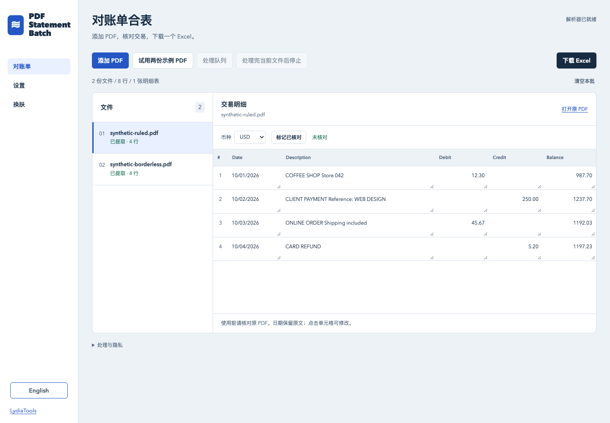

# 对账单合表 · PDF Statement Batch

**一批 PDF 对账单，合成一份能核对的 Excel。**

在浏览器里处理文字型 PDF，检查和修改交易，导出明细与完整文件清单。支持中英文，不需要注册或 AI API 密钥。

[打开中文版](https://lydiatools.github.io/pdf-statement-batch/?lang=zh) · [English app](https://lydiatools.github.io/pdf-statement-batch/) · [v0.2.2 预览版](https://github.com/LydiaTools/pdf-statement-batch/releases/tag/v0.2.2)



关闭金额数字导出后，明细字段按文本导出，保留金额中的千位分隔符和前后空格。

## 操作

1. 添加多份 PDF，或先试用两份虚构示例。
2. 处理队列，逐份检查交易，必要时修改单元格、确认币种。
3. 如需稍后继续，在「批次」里保存 ZIP；下次打开即可恢复原 PDF、修改内容和核对进度。
4. 下载 Excel。同结构、同币种的明细合表；失败、取消、重复文件也会出现在文件清单中。

日期保留原文。明确的金额列可导出为数字；进入导出阶段且仍为文本的含糊格式和高精度数值保留文本；解析过程中仍可能错列或丢失金额，必须对照原 PDF。以 `=` 等字符开头的描述按文本保存，不会作为公式执行。

## 本机运行

发行版 ZIP 已包含 `app/` 文件夹；解压后使用 Python 3 启动：

```sh
python3 -m http.server 4173 --bind 127.0.0.1 --directory app
```

打开 `http://127.0.0.1:4173/?lang=zh`。首次使用仍需联网下载运行环境。

## 从源码构建

需要 Node.js 20+ 和 Python 3。构建和启动无需 npm install。

```sh
node scripts/build.mjs
python3 -m http.server 4173 --bind 127.0.0.1 --directory dist
```

打开 `http://127.0.0.1:4173/?lang=zh`。

## 文件与处理范围

PDF 与提取结果只保留在当前标签页，不上传、不调用 AI、不接统计代码。首次使用需要从版本固定的 jsDelivr 地址下载 Python 环境及依赖；CDN 可见普通网络请求信息，但不会收到你的 PDF 内容。成功加载并保留缓存后才能尝试断网使用，全新浏览器离线不可用。关闭标签页会清除当前批次。如需继续复核，请先选择「批次 → 保存批次」，之后用「打开已保存批次」载入 `.psb.zip` 文件。它包含原 PDF、修改过的交易、核对标记、待处理状态和设置，不必再次选择原文件。本预览版不会自动在浏览器存储中保存财务文件。保存的 ZIP 含可读取的财务内容，请妥善保管。

主分支提供[网络观察测试](tests/network-boundary.mjs)：真实浏览器处理两份原创虚构 PDF，检查观察到的请求方法、请求体和目标主机；测试专用后台线程先发送一条 POST，确认监听器能看到该请求。此测试禁用 Service Worker，只观察页面 WebSocket，未覆盖 Service Worker 通信、所有浏览器或所有数据编码方式；它是可复现的回归检查，不能证明所有路径都满足隐私要求。v0.2.2 发行包早于这项测试。

保存批次最多支持 100 MB 原文件、1,000 份文件；恢复前检查哈希，失败不会替换当前批次。该批次文件与软件发行版 ZIP 不同。

文本回退解析可能改变金额符号或精度，因此金额留空，请逐项对照原 PDF 填写。支持文字型 PDF，单份不超过 50 MB。扫描件需先识别，加密文件需先解锁。解析不等于财务核验，陌生格式可能漏行、错列。来源标记为文件和提取行序，不是精确 PDF 页码。币种只读取明确的 `Currency: XXX` 字段或由你选择；未确认币种的文件分别成表。不会根据金额删除不同文件里的交易。

## 失败诊断

文件标为失败时，可下载仅含固定错误类别、预览版本与失败数量的诊断。它不是脱敏账单，也不含可复现 PDF。解析环境初始化失败时文件仍待处理，不显示单文件诊断。固定发行版 v0.2.0 不包含此功能，v0.2.1 已包含。[详细说明](docs/diagnostic-preview.zh-CN.md) · [English](docs/diagnostic-preview.md)

[日期观察与文本回退金额处理](docs/date-observations.zh-CN.md) · [English](docs/date-observations.md)

## 致谢

复用 Priyanshu Dangi 的 MIT 许可 PDF 解析核心，保留原署名和许可。LydiaTools 新增批处理队列、双语复核与 Excel 集成，不认领原作者的解析技术。详见 [来源与许可](NOTICE.md)。两份测试 PDF 均为原创虚构数据，不含真实账单。

[英文说明](README.md) · [LydiaTools](https://github.com/LydiaTools)

## 已验证的范围

真实浏览器已处理 500 份字节不同的测试 PDF，导出 2,000 行，并通过停止、保存批次、断网重载、重新打开、继续剩余原文件及 Excel 独立重读。18,000 个数据字段和 500 份文件状态逐项检查通过。输入基于两种原创虚构版式，加入不同 PDF 尾注以保证每份都实际解析，不是 500 家银行的覆盖测试。另验证扫描件、加密件、损坏文件、重复文件、不同列结构与币种分表，以及中英文和手机布局。

[实测记录](docs/validation.json)。首次下载运行环境在本轮网络中约需两分钟；缓存完整后已验证断网重载。这是早期预览版，真实用户采用和银行格式覆盖仍需后续验证。公开反馈请使用原创或充分脱敏的复现样本，不要上传个人账单。
